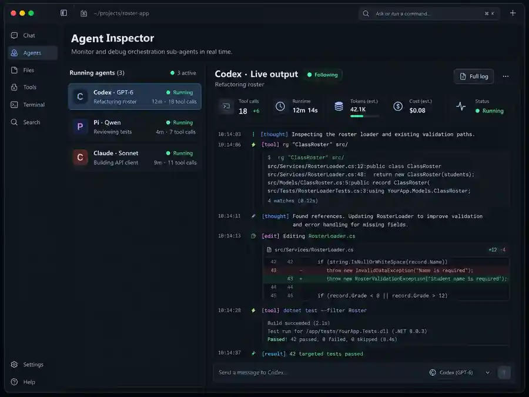

# SonoranClaudeRouter

Cross-provider visibility for Claude-orchestrated coding agents.

**Status: design proposal.** This repository contains the Agent Inspector concept, implementation plan, integration research, and mockup. It does not yet contain a working router, monitoring service, or Claude Code mod. The existing orchestration skill described in the project brief has not been imported or audited here.

## The problem

The existing workflow uses Claude to delegate work according to task complexity and available usage across Claude, Codex, and OpenRouter-backed workers. Long-running delegates are difficult to inspect without asking the orchestrator for an update.

Agent Inspector would show each worker's actual emitted activity: messages, tool calls, command output, edits, test results, errors, and available usage metadata. It adds visibility to the existing routing workflow rather than replacing its scheduling or model-selection policy.

## Concept mockup

*Illustrative, AI-generated design concept, not a screenshot of working software. Model names, timestamps, metrics, code, and test outcomes are fictional. The repository image is a web-optimized preview of the conversation's mockup. See [asset notes](docs/assets/README.md).*

The preferred experience is an inspector close to the Claude Code conversation: select a worker and follow its output without repeatedly requesting status. Native panel support is a feasibility gate, not an established dependency. A companion terminal or local browser viewer is the fallback if the installed Claude Code version cannot host the required interface.

## Documentation

| Document | Contents |
| --- | --- |
| [Agent Inspector design](docs/AGENT_INSPECTOR_DESIGN.md) | User experience, architecture, event contract, privacy, and scope boundaries. |
| [Implementation plan](docs/IMPLEMENTATION_PLAN.md) | Ordered milestones, proof requirements, and acceptance checks. |
| [Integration research](docs/INTEGRATION_RESEARCH.md) | Primary-source references, documented interfaces, and compatibility questions. |
| [Mockup asset notes](docs/assets/README.md) | Image provenance, checksum, and differences between the illustration and the proposed MVP. |

## Proposed first release

A read-only agent list and live transcript viewer, backed by a local collector and adapters around existing worker launch paths. Start with a compatibility spike, then one Claude path and one Codex path before expanding to Pi and other OpenRouter-backed runtimes.

The monitor must not grant permissions, inject prompts, change routing, relaunch workers, or terminate tasks when its UI closes. It must label unavailable information honestly rather than inventing reasoning, completion percentages, or remaining subscription usage.

**Next proposed task:** complete Phase 0 of the [implementation plan](docs/IMPLEMENTATION_PLAN.md). Documentation does not authorize implementation or changes to the existing orchestrator.
